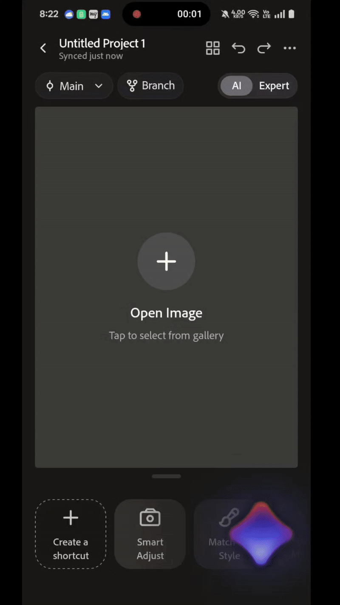
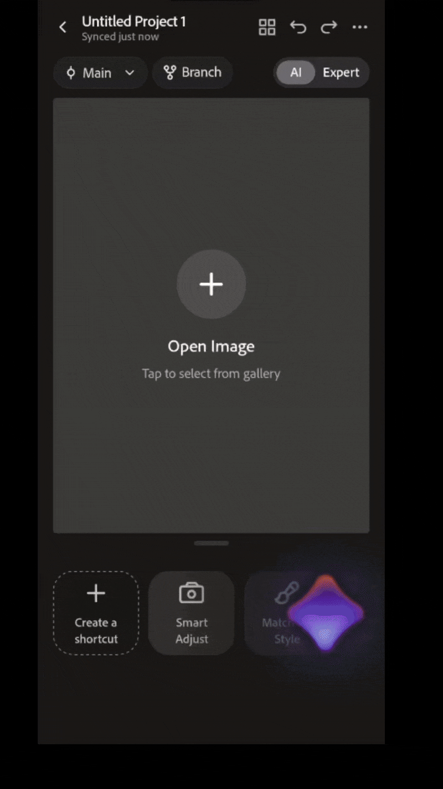

# Art Style Transfer: a photo editor for 2030

Feather, Inter IIT Tech Meet 14.0 · Dev Lead, Product and Tech

Dec 2025

Adobe's problem statement at Inter IIT Tech Meet 14.0 asked for the photo editor of 2030, running on limited hardware. Feather was our answer: a phone editor where you describe an edit in plain words, restyle a photo after a piece of art, and get help writing the prompt as you type.

We were a   six-person team across research, design, ML and engineering, as the lead for product and tech. We placed 8th of 23 IITs and presented to Adobe's product team.

**Try it yourself:** [download the live APK](https://drive.google.com/file/d/1nICpp2gTIEjmFVx9OHsYsuKafsVAi3dM/view)

**Feather, screen by screen**

- An empty project, with Main and Branch at the top and AI and Expert beside them.
- A photo in, and Feather suggests edits for it: "Enhance the warm, golden light".
- Ghost text. You type "Make it noir and reduce it's" and the phone offers the rest.
- Suggestions change with the photo: a portrait gets "Enhance pink hair, mute background".
- The Smart Adjust pad. Touch the point between bright, dark, sharp and soft.
- Expert mode swaps the pad for sliders: exposure, contrast and the rest.

Frames from the team's screen recordings of the working app.

## Split between phone and cloud

"Limited hardware" decided the architecture. Anything that has to feel instant runs on the phone, and anything heavy goes to the cloud.

**What runs where**

The line between them is latency. If you are waiting on every keystroke, it can't go over the network.

A quantized Llama 3.2 1B runs on the phone (via ExecuTorch) and finishes your prompt as you type. It works offline and costs nothing per suggestion. SDXL runs in the cloud on Modal for style transfer, Gemini refines prompts and suggests edits, and filters run in real time on the phone through `expo-gl`.

| Runs on the phone | Runs in the cloud |
| --- | --- |
| Ghost text (Llama 3.2 1B, quantized) | Art style transfer (SDXL on Modal) |
| Real-time filters (`expo-gl`) | Semantic editing and multi-step workflows (Modal) |
| Smart Adjust pad and Expert sliders | Prompt refinement and smart suggestions (Gemini API) |

## Help with the words

Describing an edit is harder than it sounds. "Make it better" gives a model nothing to work with. So the prompt box finishes your sentence in grey as you type, a Refine button turns a short prompt into a detailed one, and if typing is the problem, you can talk to the assistant instead.

**Ghost text in the prompt box**

<p align="center">
  
</p>

<p align="center"><em>Real-time autocomplete: suggestions appear in grey as you type, and Refine expands a short prompt into a detailed instruction using Google Gemini.</em></p>

Feather also looks at the photo and suggests edits for it. On a sunset over the water it offered "Enhance the warm, golden light". On a portrait with pink hair, "Enhance pink hair, mute background". The suggestions are the prompt you might have written if you had known what to ask.

You can also ask for edits directly in natural language, like "Make the sky more dramatic" or "Remove the bird".

## When words aren't enough

Some edits are easier to point at than to say. Smart Adjust has a pad with bright and dark on one axis and sharp and soft on the other. You touch the feel you want, and in the app's own words, "the more you refine, the better Kimi adapts to your unique creative style."

**Pointing instead of describing**

<p align="center">
  
</p>

<p align="center"><em>Smart Adjust on our demo photo: brightness up and down, contrast or softness left and right.</em></p>

## Restyle after a piece of art

Art Style Transfer turns a photo into something painted, using a set of curated art styles. It's the heaviest thing Feather does, so it lives entirely in the cloud: SDXL running on Modal, behind the `match_art_style` service.

## Room to try things

Every project has a main line and branches, so you can try a direction without losing the one you had. A switch moves between AI and Expert modes, and Expert swaps the pad for real sliders, exposure, contrast and the rest, for people who'd rather set the numbers themselves. Around all of it is an infinite canvas you can zoom and pan across to explore what you've made.

## How it's built

The app is React Native on Expo, with the heavy models behind it on Modal.

**Mobile client** (`/`)

- React Native, Expo SDK 54, JavaScript/JSX
- State through React Hooks and Context
- On-device logic for ghost suggestions
- Google Gemini API for prompt refinement and smart suggestions
- `expo-gl` for real-time filters
- A custom theme system in `constants/Theme.js`

**Backend services** (`/backend`), deployed on Modal

- `photo_art_agent` handles semantic editing and complex workflows
- `match_art_style` generates stylized images with SDXL

See [`backend/README.md`](backend/README.md) for details.

**Local server** (`main.py`)

A small FastAPI server for testing local LLM capabilities and serving some local features.

**Models**

- Google Gemini (Flash 1.5 / 2.5) via API
- Llama 3.2 1B, quantized, on device via ExecuTorch
- SDXL in the cloud

## Running it yourself

**You'll need**

- Node.js and npm or yarn
- Expo CLI
- Python 3.10+ (for the local backend)
- Android Studio or Xcode (for simulators)

**Steps**

1. Clone the repository

   ```bash
   git clone https://github.com/NiharRD/ArtStyleTransfer.git
   cd ArtStyleTransfer
   ```

2. Install the client dependencies

   ```bash
   npm install
   ```

3. Create a `.env` file in the root directory

   ```env
   EXPO_PUBLIC_GOOGLE_API_KEY=your_gemini_api_key
   ```

4. Run the app

   ```bash
   npm start
   # then press 'a' for Android or 'i' for iOS
   ```

**Where things live**

- Frontend work happens in `app/`, `components/` and `hooks/`.
- Refine calls the Gemini API directly from `hooks/useRefinePrompt.js`, so it no longer needs the local Python server.
- Backend services are deployed to Modal; see `backend/README.md`.

## What I'd measure

Edits people keep

- **Ghost text taken:** suggestions people accept as they type
- **Undo rate:** edits reversed straight away
- **Time to first edit:** from opening a photo
- **Cloud cost per kept edit:** what SDXL costs for each image kept

The last one is the one Adobe's brief was really about. On limited hardware, a cloud edit nobody keeps is pure cost, and the phone should be doing everything it can before you pay for the cloud.

## Contributing

This is a private repository. Please contact the maintainer for access.

[GitHub](https://github.com/NiharRD/ArtStyleTransfer)
